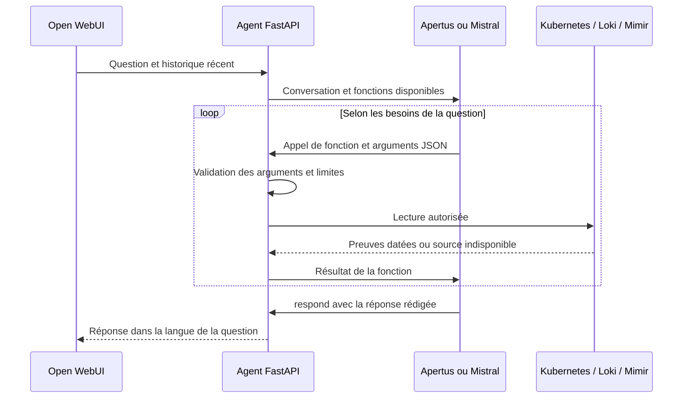

# Agent conversationnel et outils de lecture

Le mode courant, `KUBEAI_CHAT_MODE=agent`, laisse le modèle comprendre la
question et le contexte du chat. Le serveur lui décrit les fonctions disponibles
avec leurs arguments typés. Le modèle choisit les appels, lit les résultats,
puis rédige sa réponse. Aucun mot particulier n'est requis dans la question.



## Fonctions disponibles

| Fonction | Données lues |
|---|---|
| `get_cluster_inventory` | Nœuds, pods, événements et consommation mesurée ; périmètre cluster ou namespace configuré. |
| `find_latest_incident` | Anomalies horodatées des logs conservés et avertissements Kubernetes ; renvoie la ressource et la fenêtre UTC. |
| `get_incident_evidence` | Logs, événements et historique CPU/mémoire/HTTP du pod sur une fenêtre précise. |
| `get_logs` | Extraits Loki, y compris pour un pod supprimé ; dix dernières minutes par défaut. |
| `get_metrics` | Mesures actuelles ou historique des métriques disponibles. |
| `get_events` | Événements Kubernetes encore conservés ; dernière heure par défaut. |
| `respond` | Termine par une réponse, une demande de précision ou une explication du périmètre. |

Le modèle peut appeler `find_latest_incident`, reprendre le pod et les dates
renvoyés dans `get_incident_evidence`, puis répondre à partir de ces preuves.
Les bornes découvertes sont arrondies vers l'extérieur à la seconde pour
conserver les marqueurs horodatés à la fraction de seconde. Les réponses
historiques incluent une référence issue des outils (namespace/pod et bornes
UTC), afin qu'une relance puisse reprendre le même épisode même si le modèle
omet cette référence dans sa prose.
Les critères techniques de détection des anomalies dans les logs et les
validations des noms/dates restent du code déterministe ; ils ne classent pas
la question utilisateur.

## Langue et contexte

Le modèle reçoit l'instruction de répondre dans la langue de la dernière
question, de respecter une demande explicite de changement de langue et de
conserver les noms techniques et les citations de logs. Aucun réglage de langue
dans `.env` n'est nécessaire. Le protocole local rappelle explicitement la
question d'origine pour que la langue des résultats techniques ne prenne pas
le dessus sur celle de l'utilisateur. Exemples :

- « Peux-tu regarder ce qui a déraillé dans l'application récemment ? »
- « Could you investigate what went wrong most recently? »
- « What do the logs and CPU measurements tell us about that failure? »
- « Explain the recovery in English. »

L'agent conserve jusqu'à six messages récents précédant la question. Les
anciennes réponses servent à comprendre le sujet ; toute nouvelle affirmation
de monitoring doit s'appuyer sur une nouvelle lecture. Le contexte peut être
réduit si les résultats des outils deviennent volumineux.

## Exécution et limites

Les fonctions sont des `StructuredTool` LangChain Core avec des schémas
Pydantic. Le transport `httpx` adapte le protocole au fournisseur : appels
natifs pour Mistral, décision JSON contrainte par schéma pour le profil local.
Dans les deux cas, le modèle choisit la fonction et ses arguments ; le même
contrôleur valide et exécute les lectures. Le backend refuse les fonctions inconnues, arguments supplémentaires
et fenêtres historiques de plus de six heures. Un nom de pod doit provenir
de la conversation ou d'un résultat de source lu pendant cette analyse ; un
nom inventé est refusé avant toute requête. Ce contrôle valide les arguments,
sans choisir les outils à partir de mots dans la question. Les résultats volumineux sont
réduits avec un indicateur de troncature. Les secrets détectables sont masqués.

Le contrôleur exige au moins une lecture réussie avant `respond(kind=answer)` ;
la découverte seule ne suffit pas. Le prompt impose de citer les preuves,
de distinguer faits et hypothèses et de signaler les sources absentes.
Cette règle ne prouve pas chaque phrase : l'interprétation dépend du modèle.

Le compte Kubernetes reste en lecture seule. Aucun outil de shell, remédiation,
URL libre ou requête PromQL/LogQL arbitraire n'est exposé. Les instructions
contenues dans les logs sont présentées comme des données non fiables.

```dotenv
KUBEAI_CHAT_MODE=agent
KUBEAI_TOOL_PROTOCOL=auto
KUBEAI_AGENT_MAX_STEPS=8
KUBEAI_AGENT_TIMEOUT_SECONDS=180
```

Ces valeurs sont les valeurs par défaut au démarrage du processus. Le budget
couvre les appels de fonctions et les tours du modèle ; chaque appel LLM garde
aussi son timeout fournisseur. Une erreur n'active aucun routeur de secours.
Le mode explicite `legacy` conserve l'ancien parcours déterministe pour les
intégrations existantes et leurs tests. Le déploiement courant utilise `agent`.

`POST /diagnose` expose dans `observation.tools` les fonctions effectivement
exécutées et leurs résultats bornés. Le chat utilise le même contrôleur ; en
SSE, il envoie des commentaires de maintien de connexion pendant l'analyse,
puis le texte final. Les outils internes ne sont pas fournis par le client.

`KUBEAI_TOOL_PROTOCOL=auto` utilise les appels natifs (`tools`, `tool_calls`)
pour Mistral et `response_format: json_schema` pour les serveurs locaux. Le
format local impose un objet `name` + `arguments`, converti en appel au même
registre. Cela évite qu'Apertus raconte une utilisation d'outils sans en appeler.
Les modes explicites `native` et `json` permettent d'adapter un autre moteur.
Une capacité absente, une sortie invalide ou un budget épuisé provoque une erreur
explicite. Aucun texte libre du modèle n'est exécuté comme commande.
