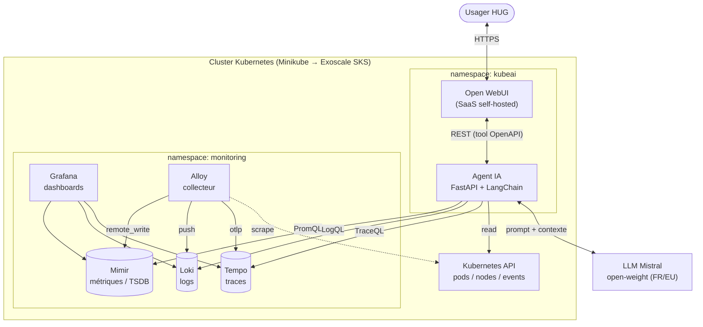

# Group-17 — Architecture

> **Cours** : Cloud Services and Systems (MSE)
> **Projet** : KubeAI — Assistant IA d'observabilité Kubernetes (HUG, Genève)
> **Groupe** : 17
> **Date** : 15 octobre 2026

---

## 1. Vue d'ensemble

KubeAI est un **assistant conversationnel d'observabilité Kubernetes**. L'utilisateur pose des questions en langage naturel sur l'état d'un cluster ; un agent IA traduit ces questions en requêtes vers la stack d'observabilité (les quatre signaux : **métriques, logs, traces, événements**), agrège les résultats et les fait analyser par un LLM souverain avant de restituer une réponse.

L'architecture suit le **modèle de référence en 4 couches** de l'énoncé :

```
Couche 4 — User Interface      : Open WebUI
Couche 3 — AI agent            : FastAPI + LangChain  (+ LLM Mistral)
Couche 2 — Observability       : métriques (Mimir), logs (Loki),
                                 traces (Tempo), événements (K8s API)
                                 — collecte unifiée par Grafana Alloy
Couche 1 — K8s cluster         : workloads supervisés (pods, nodes)
```

L'ensemble est déployé sur **Kubernetes** : en local sur **Minikube** (phase de développement) puis sur **Exoscale SKS** (cloud souverain suisse) pour la production. Le choix d'un cloud suisse et d'un LLM européen open-weight répond aux contraintes de **souveraineté et de confidentialité des données de santé** des HUG (RGPD, LPM, HDS).

---

## 2. Figure — Architecture

### 2.1 Schéma de déploiement

```
                              ┌──────────────────────────────────────────────────────────────┐
                              │   Cluster Kubernetes (Minikube local → Exoscale SKS cloud)     │
                              │                                                                │
   ┌───────────┐  HTTPS/REST  │  ┌───────────── namespace: kubeai ─────────────┐               │
   │           │◀────────────▶│  │                                             │               │
   │   Usager  │              │  │   ┌──────────────┐        ┌──────────────┐  │               │
   │ (médecin/ │              │  │   │  Open WebUI  │◀──────▶│   Agent IA   │  │               │
   │  SRE HUG) │              │  │   │  (SaaS self- │  REST  │  FastAPI +   │  │               │
   │           │              │  │   │   hosted)    │        │  LangChain   │  │               │
   └───────────┘              │  │   └──────────────┘        └──────┬───────┘  │               │
                              │  │        ▲ Service               │ outils     │               │
                              │  │        │ (LoadBalancer/Ingress)│            │               │
                              │  └────────┼───────────────────────┼───────────┘               │
                              │           │                       │                           │
                              │           │        ┌──────────────┼───────────────┐           │
                              │           │        │ PromQL  LogQL  TraceQL K8s API  │        │
                              │           │        │ ▼       ▼      ▼       ▼ (pods/events)│      │
                              │           │        ▼                                     │       │
                              │  ┌──────── namespace: monitoring ─────────────────────────┐   │
                              │  │                                                         │   │
                              │  │ ┌───────┐ ┌───────┐ ┌───────┐ ┌─────────┐ ┌─────────┐  │   │
                              │  │ │ Mimir │ │ Loki  │ │ Tempo │ │ Grafana │ │  Alloy  │  │   │
                              │  │ │(métr.)│ │(logs) │ │(trace)│ │ (dash)  │ │(collecte)│ │   │
                              │  │ └───▲───┘ └───▲───┘ └───▲───┘ └─────────┘ └────┬────┘  │   │
                              │  │     │remote_ │ push    │ otlp                  │       │   │
                              │  │     │write   │         │                       │       │   │
                              │  │     └────────┴─────────┴───────────────────────┘       │   │
                              │  │            (scrape métriques + logs + traces des        │   │
                              │  │             pods/nodes ; événements via K8s API)        │   │
                              │  └─────────────────────────────────────────────────────────┘   │
                              │                                                                │
                              │  Stockage : PersistentVolumes (filesystem local / block        │
                              │  storage Exoscale) — aucun objet Minio/S3 requis               │
                              └────────────────────────────────┬───────────────────────────────┘
                                                               │ API souveraine (ou local vLLM/Ollama)
                                                               ▼
                                                      ┌─────────────────┐
                                                      │  LLM Mistral    │
                                                      │ (open-weight,   │
                                                      │  FR / EU)       │
                                                      └─────────────────┘
```

### 2.2 Flux d'une requête (séquence)

```
1. Usager → Open WebUI : question en langage naturel
2. Open WebUI → Agent IA (FastAPI) : requête REST
3. Agent IA (LangChain) : sélection des outils pertinents
      ├─▶ Mimir   (PromQL)  : métriques (CPU, mémoire, up, ...)
      ├─▶ Loki    (LogQL)   : logs applicatifs
      ├─▶ Tempo   (TraceQL) : traces distribuées (latence, chaîne d'appels)
      ├─▶ K8s API           : état des pods / nodes
      └─▶ K8s API           : événements du cluster
4. Agent IA : agrégation en un « contexte enrichi »
5. Agent IA → LLM Mistral : contexte + question → analyse / diagnostic
6. LLM → Agent IA → Open WebUI → Usager : réponse en langage naturel
```

### 2.3 Diagramme Mermaid (optionnel, pour rendu PDF)



---

## 3. Description des composants

### 3.1 Classification par catégorie de service cloud

| Catégorie | Composant | Rôle dans l'architecture |
|-----------|-----------|--------------------------|
| **IaaS / VM** | Nœuds Kubernetes (Minikube local, instances compute Exoscale SKS) | Fournissent le CPU/RAM/disque qui exécutent tous les conteneurs. En local : 1 VM Minikube (4 vCPU, 7 Go RAM) sur driver Docker/OrbStack. En cloud : pool de VM managées par Exoscale. |
| **CaaS / Orchestrateur** | Kubernetes (v1.35) + Helm | Orchestration des conteneurs, scheduling, réseau, stockage, RBAC. Deux namespaces : `kubeai` (applicatif) et `monitoring` (observabilité). |
| **Base de données (TSDB)** | Grafana Mimir | Base de données de **séries temporelles** (métriques). Déploiement monolithique (`target: all`), stockage sur PersistentVolume filesystem, sans Minio. Interroge via API Prometheus-compatible (PromQL). |
| **Base de données (logs)** | Grafana Loki | Magasin de **logs** indexé par labels. Mode SingleBinary, stockage filesystem. Interrogé en LogQL. |
| **Base de données (traces)** | Grafana Tempo | Magasin de **traces** distribuées (latence, chaîne d'appels inter-services). Alimenté par Alloy en OTLP, interrogé en TraceQL. *(signal « traces » de l'énoncé — optionnel en local, prévu pour la phase cloud.)* |
| **Collecte / Agent** | Grafana Alloy (chart `k8s-monitoring`) | Agent de collecte déployé en DaemonSet : scrape les métriques, récupère les logs et les traces des pods/nodes, puis `remote_write` vers Mimir, `push` vers Loki et `OTLP` vers Tempo. |
| **SaaS self-hosted (visualisation)** | Grafana | Dashboards de supervision, datasources Mimir + Loki préconfigurées. Outil d'exploration pour l'équipe SRE. |
| **SaaS self-hosted (interface)** | Open WebUI | Interface conversationnelle auto-hébergée par laquelle l'usager pose ses questions. Branchée sur l'Agent IA via le mécanisme **« tool »** (OpenAPI/function-calling) et sur le LLM Mistral. |
| **Application / Backend (microservice)** | Agent IA — FastAPI + LangChain | Cœur applicatif : expose une API REST, interprète l'intention, orchestre les outils (PromQL, LogQL, K8s API, événements), agrège le contexte et appelle le LLM. Déployé en Deployment + Service + ConfigMap + RBAC. |
| **FaaS / Model-as-a-Service** | LLM Mistral (open-weight) | Génération des réponses en langage naturel. Consommé soit via une **API souveraine** (modèle européen, facturé à l'usage façon FaaS), soit déployé **localement** (Ollama / vLLM) sur le cluster pour garantir qu'aucune donnée ne sort de l'infrastructure. |
| **Stockage persistant** | PersistentVolumes / PVC (filesystem local, Block Storage Exoscale) | Persistance des données Mimir (TSDB), Loki (chunks/index) et état applicatif. Chiffrement au repos côté Exoscale en production. |
| **Réseau / Exposition** | Service K8s (ClusterIP interne), Ingress / LoadBalancer | Communication interne entre composants (ClusterIP) et exposition externe sécurisée (Ingress + TLS en local, LoadBalancer Exoscale en cloud). |

### 3.2 Détail des composants clés

**Agent IA (FastAPI + LangChain)** — composant central et seul développé sur mesure (image Docker propre). Il expose des **endpoints REST qui retournent métriques et logs** (ex. `GET /metrics`, `GET /logs`, `POST /ask`) consommés par Open WebUI. Via LangChain, il dispose d'un jeu d'**outils** : `query_metrics` (PromQL → Mimir), `query_logs` (LogQL → Loki), `query_traces` (TraceQL → Tempo), `get_pod_status` et `get_events` (Kubernetes API). Il assemble les données brutes en un contexte structuré transmis au LLM. Contrôlable et auditable — essentiel pour la traçabilité des décisions en contexte médical.

**Intégration Open WebUI ↔ Agent IA (« tool »)** — conformément à l'énoncé (Step 3), Open WebUI est configuré pour appeler l'Agent IA comme un **« tool »** : l'API FastAPI est exposée via un schéma OpenAPI que Open WebUI importe, permettant au LLM de déclencher les appels (function-calling) pour récupérer métriques/logs/traces avant de formuler sa réponse. Le même LLM Mistral est configuré à la fois dans Open WebUI et dans l'agent.

**Mimir (métriques)** — remplace un Prometheus classique par une TSDB scalable. Déployée ici en mode monolithique simple (sans Minio ni Kafka) pour rester légère en local, avec une trajectoire vers un stockage objet souverain sur Exoscale en production.

**Loki (logs)** — agrégation des logs par labels Kubernetes (namespace, pod, container). Mode SingleBinary + filesystem pour éviter la dépendance à un stockage objet en local.

**Tempo (traces)** — quatrième signal d'observabilité de l'énoncé. Reçoit les traces distribuées via Alloy (OTLP) et les expose en TraceQL. Optionnel en environnement local Minikube (contrainte de ressources), déployé en priorité sur Exoscale pour l'analyse de latence inter-services.

**Alloy (collecte)** — point d'entrée unique de la télémétrie : il découvre dynamiquement les cibles du cluster et alimente Mimir et Loki. Un seul agent couvre métriques et logs.

**Open WebUI + LLM Mistral** — Open WebUI fournit l'expérience « chat » ; Mistral (open-weight, européen) assure la génération. Le couple garantit qu'aucune donnée de télémétrie ne quitte l'infrastructure souveraine.

---

## 4. Choix d'architecture et souveraineté

| Enjeu | Choix retenu | Justification |
|-------|--------------|---------------|
| Hébergement | Exoscale (Suisse) | Cloud souverain, datacenters en Suisse, conforme à la localisation des données de santé. |
| Orchestration | Kubernetes + Helm | Standard open-source, pas de vendor lock-in, portable local ↔ cloud. |
| Observabilité | Mimir + Loki + Alloy + Grafana | Stack open-source Grafana, auto-hébergeable, sans Minio en local. |
| LLM | Mistral (open-weight, FR/EU) | Modèle européen, déployable localement, pas de dépendance à un fournisseur non souverain. |
| Interface + Agent | Open WebUI + FastAPI/LangChain | Open-source, auditable, contrôle total du flux de données. |

**Principe directeur** : aucune donnée de télémétrie ou de log ne quitte l'infrastructure souveraine ; le LLM est déployable localement ou via une API souveraine.

---

## 5. État de déploiement (15 oct. 2026)

| Composant | Catégorie | Statut |
|-----------|-----------|--------|
| Minikube / Kubernetes | IaaS + CaaS | ✅ Running |
| Loki | DB logs | ✅ Running (SingleBinary) |
| Mimir | DB métriques (TSDB) | ✅ Running (monolithique) |
| Tempo | DB traces | ⏳ Optionnel / phase cloud |
| Alloy | Collecte | 🔄 En cours de déploiement |
| Grafana | SaaS visualisation | ⏳ À déployer |
| Agent IA | Application | ⏳ À développer |
| Open WebUI | SaaS interface | ⏳ À déployer |
| LLM Mistral | FaaS / MaaS | ⏳ À intégrer |

---

*Document d'architecture — à exporter en `Group-17-Architecture.pdf`.*
