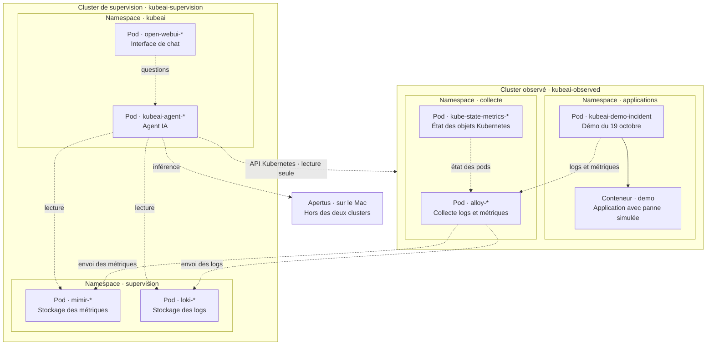

# Deux clusters : applications et supervision

La [validation du 27 octobre](validation-two-clusters-2026-10-27.md) décrit les
tests automatisés, la démo réelle et son nettoyage.

Un **cluster** contient des **namespaces**. Chaque namespace contient des
**pods**, et chaque pod contient un ou plusieurs **conteneurs**. Les boîtes
ci-dessous montrent cette hiérarchie ; les flèches pointillées représentent
les échanges de données. Les namespaces système Kubernetes sont omis.



Les suffixes `-*` sont générés par les Deployments Kubernetes. La démo crée
son pod directement, avec le nom stable `kubeai-demo-incident`. Les namespaces
de chaque cluster ont volontairement des noms distincts.

## Commandes

Ouvrir Docker Desktop et démarrer Apertus séparément si ce fournisseur est
sélectionné. Depuis la racine du dépôt :

| Action | Mac/Linux | PowerShell |
|---|---|---|
| Démarrer les deux clusters et WebUI | `bash start.sh` | `./start.ps1` |
| Lancer l'incident dans le cluster observé | `bash start-failure.sh` | `./start-failure.ps1` |
| Nettoyer les pods de démonstration | `bash stop-failure.sh` | `./stop-failure.ps1` |

Le scénario reproduit la démonstration historique du 19 octobre, avec des
horodatages actuels : 90 secondes normales, 90 secondes de hausse CPU et de
réponses HTTP 500, puis 60 secondes de récupération. Les quatre marqueurs
`normal`, `anomaly_start`, `recovered`, `complete` délimitent le cycle.
Un scénario en cours n'est pas remplacé par `start-failure`.

`stop-failure` peut interrompre ou supprimer la démo. Il cible uniquement les
noms et labels des pods et du ConfigMap de démonstration, dans le cluster observé. Alloy,
kube-state-metrics et toute la supervision continuent de fonctionner.
Les preuves déjà reçues restent consultables selon la rétention Mimir/Loki.

Ouvrir <http://127.0.0.1:8080> et choisir **kubeai**. Après `complete`, demander
« Analyse le dernier incident », puis « Pour ce même
incident, corrèle les logs, le CPU et les erreurs HTTP ».

On peut simplement demander **« Analyse le dernier incident »** : l'agent
cherche le pod et la période à partir des logs d'anomalie et des avertissements
Kubernetes du namespace observé. La réponse annonce le périmètre de recherche
et ses limites. Voir le [fonctionnement de la découverte automatique](demo-scenarios.md#b--investigation-historique-et-chronologie).

Le modèle choisit lui-même les fonctions de lecture à partir du contexte de la
question et rédige la réponse dans sa langue. Le [diagramme de la boucle
d'outils](agent-tools.md) complète la hiérarchie physique ci-dessus.

## Configuration dans .env

```dotenv
KUBEAI_SUPERVISION_CLUSTER=kubeai-supervision
KUBEAI_OBSERVED_CLUSTER=kubeai-observed
KUBERNETES_NAMESPACE=applications

LLM_PROVIDER=local
LLM_BASE_URL=http://127.0.0.1:11435/v1
LLM_MODEL=apertus-8b
LLM_API_KEY_FILE=.cache/apertus/api-key
LLM_TIMEOUT_SECONDS=180
```

Les deux premières variables nomment les profils Minikube. La troisième
choisit le namespace applicatif par défaut de la démo ; la collecte et les
requêtes couvrent **tous les namespaces** du cluster observé, y compris ceux
créés après le démarrage. Les namespaces techniques `collecte`, `supervision`
et `kubeai` sont réservés à leur rôle.
Modifier le `.env`, puis relancer `start`. Choisir un nom de pod dans le chat
ne nécessite pas de modifier le `.env` ; il n'y a pas d'ID Docker à renseigner.

Le démarrage conserve les contextes réellement utilisés dans
`.cache/topology.json`, sans identifiants. Les lanceurs de démo et de nettoyage
lisent cet état pour cibler la même installation. Un argument explicite permet
de remplacer le contexte pour une commande particulière.

## Réseau et droits

Les deux profils ont des API Kubernetes, nœuds et réseaux de Services distincts.
Une interface Docker supplémentaire les relie au réseau local `kubeai-private`
(`192.168.79.0/24`). Alloy envoie les métriques au NodePort 30009 de Mimir et les
logs au NodePort 30310 de Loki. Ces endpoints sont destinés à cette démonstration
locale sur un réseau de confiance ; ils ne sont pas publiés sur Internet.

Pour les redémarrages, le lanceur déconnecte temporairement cette interface
avant les commandes Minikube et la reconnecte après la construction de l'image.
Cela contourne la limitation de Minikube sur les conteneurs Docker ayant deux
réseaux. Utiliser `kubectl --context kubeai-observed ...` ou
`kubectl --context kubeai-supervision ...` pour inspecter les clusters.

L'agent utilise un kubeconfig contenant uniquement la CA du cluster observé et
un jeton du ServiceAccount lecteur. Il peut lister les nœuds, pods et événements ;
il n'a pas les droits de modifier les applications ou de lire les Secrets.
La vérification TLS reste active. Le jeton est valable 24 heures et renouvelé
à chaque `start` ; relancer `start` après une session plus longue.

Alloy ajoute `cluster=<nom du cluster observé>` aux logs et aux métriques via
les labels externes de ses composants [prometheus.remote_write](https://grafana.com/docs/alloy/latest/reference/components/prometheus/prometheus.remote_write/)
et [loki.write](https://grafana.com/docs/alloy/latest/reference/components/loki/loki.write/).
L'agent utilise ce label dans ses requêtes pour éviter de mélanger les sources.
Le jeton est obtenu avec la [TokenRequest API Kubernetes](https://kubernetes.io/docs/concepts/security/service-accounts/)
et n'est jamais écrit dans Git ni affiché dans les commandes.

Les manifests communs restent dans `k8s/`. `scripts/start-two-clusters.py` les
répartit entre les deux rôles et adapte namespaces, endpoints et identités.
Le démarrage réserve 4 Gio pour la supervision et 2 Gio pour le cluster observé,
en plus du moteur Apertus sur le Mac. Il arrête l'ancien profil `minikube`
uniquement si celui-ci héberge l'ancienne installation kubeAI.
